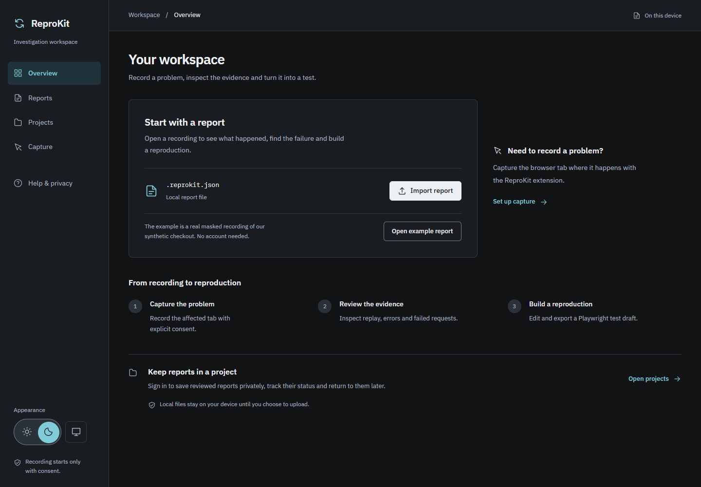

# ReproKit

Turn bugs into reproducible developer reports.

ReproKit is a browser extension and dashboard for capturing a bug in a web app and handing it to a developer with the evidence attached. You record a tab, reproduce the problem, review what was captured, and export a single `.reprokit.json` file. No account or backend is required.



## What a report contains

- A DOM session replay of the recorded tab, with form values masked
- A timeline of user interactions
- JavaScript exception and unhandled-rejection evidence, with messages masked
- Available failed `fetch` and XHR metadata: transport, sanitized URL and HTTP status
- Suggested reproduction steps and an editable Playwright test draft

Reports also declare which kinds of evidence they include, so a missing section is shown as unavailable instead of as a broken report.

## Workflows

| Workflow | Needs an account |
| --- | --- |
| Record in the extension, review, export a file | No |
| Open an exported report in the dashboard | No |
| Upload a reviewed report to a hosted project | Yes (Supabase) |

Nothing is uploaded automatically. Uploading is an explicit step after local review.

The optional [website SDK](docs/website-sdk.md) supports consented capture without the extension.

## Quick start

Requirements: Node.js 22.12 or newer and npm 10 or newer.

```bash
npm ci
npm run check        # typecheck, build, unit/database/server checks
npm run dev          # dashboard at http://127.0.0.1:5173
```

Run these commands from the repository root. For the demo, run `npm run dev:demo` in a separate terminal and open http://127.0.0.1:5174. On PowerShell systems that block `npm.ps1`, use `npm.cmd` (and `npx.cmd` for `npx`).

You can also choose **Open example report** on the dashboard to explore without installing the extension.

The demo app contains deliberate failures (an exception, a promise rejection, failed fetch and XHR requests, and a broken form) with synthetic sensitive values, so you can try the whole flow without touching a real application.

## Load the extension

```bash
npm run build -w @reprokit/extension
```

1. Open `chrome://extensions` (or `edge://extensions`) and enable Developer mode.
2. Choose **Load unpacked** and select `apps/extension/dist`.
3. Open the demo app, click the ReproKit toolbar icon, and choose **Start recording this tab**.
4. Keep the capture page open while you reproduce a bug, then stop recording.
5. Expand **Report details**, edit the title/description, choose **Save details**, then **Export report**.

The extension only requests `activeTab` and `scripting`. It has no permanent host permissions.

## Privacy

- Recording starts only after an explicit action, and only the selected tab is captured.
- Page text and form values are masked; contenteditable and explicitly masked regions are blocked.
- URL queries/fragments are removed, paths and diagnostic messages are masked, and raw stack traces are excluded.
- Cookies, storage, clipboard contents, authorization headers, request and response bodies, and raw console logs are not captured.
- Masking happens before data enters the recording buffer.

Origins, short test IDs and your title/description can remain visible. Review before sharing. See the [privacy policy](docs/privacy.md) for capture boundaries and retention.

## Hosted projects (optional)

Hosted projects use Supabase authentication, row-level security and private storage.

Use `apps/dashboard/.env.example` as a template for `apps/dashboard/.env.local`, then set your public URL and publishable key (or legacy anon key). Follow [hosted setup](docs/hosted-setup.md) for migrations, functions and Auth configuration.

Never put secret or service-role keys in browser configuration.

## Repository layout

| Path | Purpose |
| --- | --- |
| `apps/dashboard` | Report import, investigation, authentication, hosted projects |
| `apps/extension` | Manifest V3 extension: capture, review, export |
| `apps/demo` | Controlled application with deliberate failures |
| `apps/sdk-demo` | Optional website SDK sample |
| `packages/core` | Report schema, validation, sanitization, step and test generation |
| `packages/recorder` | Reusable web recording behavior |
| `supabase/` | Migrations, server functions and database policies |
| `docs/` | Architecture, privacy, build plan, and design notes |

## Testing

```bash
npm run check
npx playwright install chromium
npm run test:browser
```

Stop local dev servers before browser tests. The suite loads the built extension in Chromium and uses synthetic hosted-service fixtures; no Supabase credentials are needed.

Real backend checks are separate: see [hosted setup](docs/hosted-setup.md). Verification evidence and status are linked from the [build plan](docs/build-plan.md).

## Limitations

- Chromium browsers only (Chrome and Edge).
- Replay shows captured behavior. It does not restore server state, authentication, or the original environment.
- Generated Playwright tests are editable starting points, not guaranteed reproductions.
- Iframes, canvas and media are excluded; original images/fonts and some visual effects are not reproduced.
- Diagnostics cover available errors and completed HTTP failures; request methods and durations are not captured.
- Recording stops at 5 minutes, 10,000 combined events or 5 MiB, whichever comes first.
- Local reports live in page memory. Export before closing or reloading.

More detail is in [docs/architecture.md](docs/architecture.md).

## Contributing and security

See [CONTRIBUTING.md](CONTRIBUTING.md). To report a vulnerability, follow [SECURITY.md](SECURITY.md) and do not open a public issue.

## License

[MIT](LICENSE)
