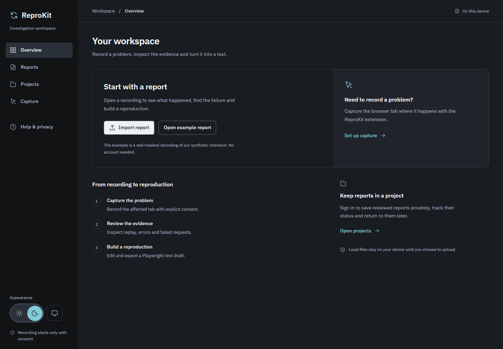

# ReproKit

Turn a browser bug into a report a developer can investigate.

ReproKit records a problem only when you choose to start, then brings masked page replay, interactions, available JavaScript errors and failed-request metadata into one investigation. Review it locally, export a portable report, draft a Playwright test, or explicitly save it to a private project.



- **Chrome and Edge extension:** explicit selected-tab capture with visible Stop and Discard controls.
- **Local investigation:** import/export, replay, timeline, diagnostics and editable report details without an account.
- **Test drafts:** derive reproduction steps and download editable Playwright source.
- **Optional private projects:** Supabase accounts, reviewed uploads, report status and project management.
- **Optional website SDK:** visitor-consented capture, local review and write-only report submission.
- **Light and dark appearance:** sun/moon controls, plus a monitor button to follow the device theme.

This is an early development project. Replay reconstructs a masked webpage rather than recording ordinary video. Test drafts require your application's setup, values and assertions. Native mobile/desktop capture is outside the current scope. See [known limitations](docs/known-limitations.md), [privacy](docs/privacy.md) and [MIT License](LICENSE).

The dashboard starts at **http://127.0.0.1:5173/**. Overview includes a real masked example of the synthetic checkout, so you can explore without an extension or account. Reports is local investigation, Projects is private saved reports, Capture explains recording, and Help & privacy contains reference material.

## Local setup

Use Node **22.12+** (tested with 24.18.0) and npm **10+** (tested with 11.16.0). From this directory:

```powershell
npm ci
npm run check
```

On PowerShell systems that block `npm.ps1`, use `npm.cmd` for the commands below.

Run in separate terminals:

```powershell
npm run dev
```

```powershell
npm run dev:demo
```

- Dashboard: http://127.0.0.1:5173
- Controlled demo: http://127.0.0.1:5174
- Optional extension UI preview: `npm run dev:extension` at http://127.0.0.1:5175 (HTTP preview does not verify extension APIs).

Ports are fixed and loopback-only. Stop an existing server if a port is occupied; the dashboard's demo link expects these ports. Demo API failures are Vite middleware, supported in both `dev` and `preview`; opening HTML directly or serving `dist` with an arbitrary static server will not supply those endpoints.

On Overview, choose **Open example report** to explore an actual masked recording of the synthetic checkout, including replay and reproduction. It is loaded only when requested; replacing an open report asks for confirmation. The separate hand-authored contract fixture is under **Help & privacy > Developer tools**.

The demo intentionally throws an exception/rejection, returns fetch 503 / XHR 502, and leaves an order unsaved. Its sensitive-looking values are synthetic; do not replace them with personal data. No values are submitted by its broken form.

## Load the extension and record

The full extension investigation page now starts with import/record choices, readable 14px body text, the review workflow and optional collapsed project saving. Appearance uses sun/moon buttons; the monitor icon follows the device theme. To see it after rebuilding, reload ReproKit at `chrome://extensions` or `edge://extensions`, then use **Open local reports** in its toolbar popup. An HTTP preview cannot exercise the installed extension.

```powershell
npm run build -w @reprokit/extension
```

1. Open `chrome://extensions` (or `edge://extensions`).
2. Enable Developer mode, choose **Load unpacked**, select `apps/extension/dist`.
3. Open the controlled demo or another supported HTTP(S) HTML tab.
4. Open the ReproKit toolbar action, read the capture explanation, and choose **Start recording this tab**.
5. Wait for the red **RECORDING** indicator, then reproduce the bug. A full capture page opens in another tab; **keep it open**.
6. Stop or discard using the selected tab's indicator or the capture page. After stopping, expand **Report details**, edit the title and description, choose **Save details**, then review **Timeline**, **Errors**, **Failed requests**, **Replay**, **Reproduction** and **Context**.
7. Choose **Export report** to download a versioned `.reprokit.json` file. Review your title/description and visible URL origins before sharing it.
8. Open the dashboard and choose **Import report**, or use **Open local reports** in the extension popup. Select the downloaded file. No account or backend is needed. Importing over an open report asks for confirmation; invalid imports preserve it and its unsaved edits.

Permissions are only `activeTab` and `scripting`; there are no permanent host permissions, storage permission, background worker or automatic uploads. A configured build permits connections only to its Supabase origin through CSP; an unconfigured build keeps `connect-src 'none'`. Capture limits remain **5 minutes / 10,000 combined events / 5 MiB serialized report**, whichever comes first. Full navigation or reload ends capture without resuming. Closing/reloading the review page or restarting the browser discards its report and temporary connection. No disk recording cache exists.

The viewer keeps **one report per open page**, in memory. **Remove report** clears that page after confirmation; it does not delete downloaded files. Cancelling import or replacement preserves the current report. Reloading/closing either viewer loses its report and edits, so export a copy first. Versions 1–4 are accepted; unsupported versions, malformed files and files above 5 MiB receive validation errors. New captures use v4. Replay is available only when a supported DOM snapshot exists; other evidence still works without it.

Replay uses locally bundled rrweb in an opaque data document and a script-disabled inner frame. External assets and network access are blocked. The extension exposes only static `replay.js`/`replay.css` bootstrap files as web-accessible resources; reports are never exposed that way.

After rebuilding, reload the extension on the extensions page. If packaging locally, zip the **contents** of `apps/extension/dist` with `manifest.json` at the archive root; do not submit it to a store. A browser toolbar action is needed to grant temporary tab access: opening the popup HTML as a normal browser tab does not grant it.

Text/form values, arbitrary DOM attributes and URL paths are masked or removed. Short unique `data-testid` tokens (up to 64 ASCII characters) and unique control roles may be retained separately for test drafts; accessible names/labels are not retained. Origins and test IDs can identify an application or tenant, so inspect them before sharing. v3/v4 capture preserves an allowlisted subset of resolved layout, spacing, sizes, borders and colours. Stylesheets, original fonts, images and media remain excluded. Pseudo-elements, transforms, continuous animations and unsupported effects may differ. Older v2 exports have no styling data and require a new recording for styled replay. Errors retain safe categories and available numeric line/column, with messages/rejection reasons masked. Failed-request evidence uses completed Resource Timing entries and does not read bodies/headers or wrap fetch/XHR: methods are unknown, unconsumed fetch bodies may delay entries, and transport/abort/timeout/hidden cross-origin failures may be unavailable. Browser-internal pages, stores, PDFs, file URLs, incognito, ReproKit's own UI, frames and non-web applications are unsupported. Read [privacy](docs/privacy.md) and inspect before sharing.

## Reproduction steps and Playwright export

1. Reload the rebuilt extension, refresh the source tab, record a flow and stop. Older imported web reports can also produce drafts from whatever actions they contain; missing locator/control metadata becomes a TODO.
2. Open **Reproduction** in the full extension page or dashboard. Review the derived steps, warnings and **Playwright source**. New reports also include the derived steps in their JSON.
3. Edit the source and choose **Export Playwright test**. The UUID-based `.spec.ts` download contains exactly your edited source. Source edits survive pane/dashboard navigation but are not stored in report JSON; export them before closing/removing the report.
4. In your application's Playwright project, put the file inside its configured test directory. Supply missing URLs, authentication, backend state, masked values, locators and app-specific waits. Replace the final TODO guard with your own assertions, adding `expect` to the import if needed.
5. Run `npx playwright test path/to/report.spec.ts` using that project's configuration. The controlled demo must be running on port 5174 if your draft targets it.

Unedited drafts deliberately stop on TODO guards; a passing click sequence alone does not prove a bug. No credentials, setup data or assertions are invented. Timings are comments, not arbitrary sleeps. Consecutive inputs to the same known target collapse into a single masked fill. Checkbox/radio state, selections, file uploads, redacted routes and ambiguous targets require manual operations. Drafts include at most 97 actions plus an explicit completion guard for omitted actions. Non-web reports and reports without web actions have no Playwright export. The viewer never evaluates or runs source, including edited/import-derived code.

For the demo, an assertion that **Submit order** saves the order should fail: its handler deliberately leaves it unsaved. Phase 4 verification executes the actual exported test with separately supplied assertions, distinguishing this intentional failure from the unfinished-draft guard.

## Connect the extension and upload

The current backend supports this flow. A normal extension build reuses the **public** Supabase URL/key in `apps/dashboard/.env.local`; optional overrides are in `apps/extension/.env.example`. `VITE_DASHBOARD_ORIGIN` defaults to `http://127.0.0.1:5173`. Never put a privileged key in either browser app. Rebuild and reload the unpacked extension after configuration/source changes:

```powershell
npm.cmd run build -w @reprokit/extension
```

1. Run `npm.cmd run dev` and `npm.cmd run dev:demo` in separate terminals. Reload the extension under `chrome://extensions` / `edge://extensions` and refresh the demo tab.
2. Record and stop, or import a report into **Open local reports**. Review evidence, edit details and choose **Save details**.
3. Below the viewer, expand **Save to a private project** and choose **Connect to dashboard**. Sign in with your existing confirmed account email/password. Account creation/password recovery happen in its dashboard link.
4. Select a project; use **Refresh projects** after creating one in the dashboard. Connection/project selection never uploads automatically.
5. Click **Upload reviewed report**. It is disabled while working or while details are unsaved. An identical retry returns the existing report; changed content under the same report ID is rejected rather than overwriting it.
6. Choose **Open saved report in dashboard**. The link contains project/report UUIDs, never tokens. Sign in there if needed; it opens the exact private report only for its owner.
7. **Disconnect** clears the temporary connection while preserving local evidence/export, including offline. Closing/reloading this review page clears both report and connection; export first. Each review page needs its own sign-in, independent of the dashboard session.

Test failure preservation by disabling network, trying upload, confirming the local report/export remain, then reconnecting and retrying. Rejected refresh credentials clear the expired connection and ask you to sign in again. Tokens never pass through the captured website or recording bridge. [Phase 6 verification](docs/verification-phase6.md).

## Verification

```powershell
npm run check
npx playwright install chromium
npm run test:browser
# Additional gates; stop dev/preview servers first:
npm run test:browsers
npm run test:performance
npm run test:clean
```

`check` runs TypeScript, all builds (including the current server validator), then 51 core/recorder/PostgreSQL/server checks. Browser tests require those built artifacts. The default product command selects its ten files explicitly and excludes your own `tests/manual-repro.spec.ts`; run that separately when ready. Playwright uses previews on 5173/5174/5176, isolated fake-service UI servers on 5177/5179 and a production CSP demo on 5178. It tests real MV3 capture, secret absence, selected-tab scope, lifecycle/permissions, import compatibility, replay isolation, source export, responsive layouts and keyboard/modal focus. The test invokes the real action to grant activeTab, then clicks its popup document in a tab; extension APIs/permissions are not mocked. Hosted UI transport fixtures are separate from the dated real hosted checks. Screenshots go to `docs/screenshots`. Restricted Windows runners may require approved process access.

`test:browsers` runs standalone native-window workflows in installed Chrome and Edge; personal profiles remain untouched. `test:performance` takes about five minutes and writes synthetic calibration/endurance results. `test:clean` verifies a fresh source copy with private env excluded, using a locked install and actual local capture/export/import, then removes its own successful temporary checkout. No actual Git clone or new cloud project is created. [Exact versions, results and limits](docs/verification-phase8.md).

Phase 4 additionally verifies real locator capture, deterministic steps, safe source escaping, masked/unsupported-operation guards, editable download and execution in a separate Playwright runner. See [Phase 4 verification](docs/verification-phase4.md), [replay layout correction](docs/verification-replay-layout.md), [Phase 3 verification](docs/verification-phase3.md), [Phase 2 verification](docs/verification-phase2.md), [historical foundation evidence](docs/verification.md), [build plan](docs/build-plan.md), [architecture](docs/architecture.md), [privacy](docs/privacy.md), [product](PRODUCT.md), and [design](DESIGN.md).

## Hosted projects: run and test

Projects have a trash button beside their name. Confirmation removes hosted reports through the existing recording-object deletion API before deleting the project and its website intake settings. Failures can leave partial deletions; review remaining reports and retry. Local/downloaded copies are unchanged. Hosted installations need the additive project-deletion migration. [Investigation refresh and deletion verification](docs/verification-investigation-projects.md).

Hosted features are optional and require your own Supabase configuration. Run `npm.cmd run dev`, open http://127.0.0.1:5173 and choose **Projects**. Follow [hosted-setup.md](docs/hosted-setup.md) to create a backend, add the public settings to `apps/dashboard/.env.local`, apply the migrations and configure Auth/function/retention. A clone includes no credentials or ownership of an existing backend. Do not rerun initial migrations over an initialized project.

Create/confirm an account → sign in → create a project. Under **Reports**, import a real demo export, expand **Report details**, edit and save reviewed details. Return to **Projects**, choose the project and click **Upload reviewed report**. Open it, inspect the existing evidence panes, change status, reload and check persistence. Use a second account/profile to check isolation; test wrong/expired auth, reset email, offline upload preservation, duplicate retry, cancelled/confirmed deletion and scheduled object cleanup. [Full checklist and live gate](docs/hosted-setup.md#7-acceptance-checks).

`npm.cmd run test:hosted` is an offline script self-check. The separately opt-in `npm.cmd run test:hosted -- --run` requires private test settings and a dedicated hosted project; it creates/removes two synthetic accounts and exercises real Auth/API/Storage. It also runs project-wide eligible retention cleanup. Mocked UI tests alone do not verify the hosted backend. [Phase 5 verification](docs/verification-phase5.md) and [Phase 6 real extension workflow](docs/verification-phase6.md).

## Workspace

```text
apps/dashboard   React/Vite local report investigation
apps/extension   MV3 consent popup, isolated content entry and capture page
apps/demo        Isolated deterministic failure scenarios
apps/sdk-demo    Separate consented website SDK integration (port 5176)
apps/shared      Shared viewer, isolated rrweb renderer, tokens and mark
supabase        Hosted migration, function, private retention schedule and tests
packages/core   v1–v4 schemas, privacy, portable files, reproduction generator and tests
packages/recorder  rrweb integration, page diagnostics, protocol and buffer
tests           Browser capture/foundation checks and rrweb spike
docs            Decisions, build plan, verification and real screenshots
```

`@rrweb/record` is bundled locally into `content.js`; `@rrweb/replay` is bundled into `replay.js`. `page.js` observes page errors/rejections and Resource Timing. The dev server builds isolated renderer assets at startup; restart it after changing the renderer. `npm.cmd run build:hosted` bundles the same core validator for the Edge Function; rebuild it before deployment. Extension upload/auth uses its trusted review page with no website-message authentication bridge. Workspace TypeScript is consumed by the bundlers; all packages are private and unpublished.

## Contributing and security

Keep changes within the current phase. Preserve privacy boundaries and add focused tests for non-trivial validation/capture/generation logic. Do not commit `.env`, real recordings, credentials or privileged keys. The separate `.env.example` files explain public browser versus private server/test settings. Report vulnerabilities privately to the repository owner; do not put sensitive evidence in public issues.

The planned web phases are implemented; deploying a live service or publishing packages/extensions is a separate owner decision. [CONTRIBUTING.md](CONTRIBUTING.md), [SECURITY.md](SECURITY.md) and [LICENSE-STATUS.md](LICENSE-STATUS.md) cover contributions, private reporting and the project license. Public intake keys/origins are forgeable; upstream abuse protection remains necessary before broad exposure. Preserve generated dependency/font notices when packaging. Keep environment files, real recordings and generated builds out of Git.
